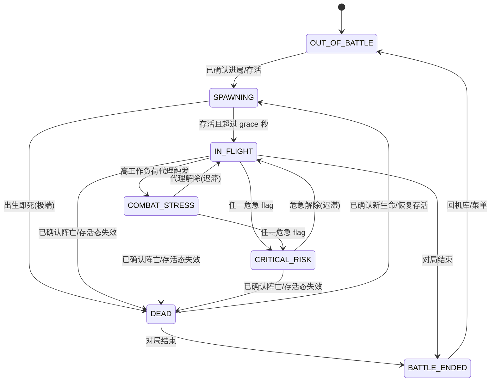

# D-B1｜Scenario 轻量 phase 模型（当前多域合同与早期设计）

> 状态：2026-10-29 对齐当前多域实现；原 v0.2 RB 空战设计已扩展。Scenario 不直接解析 map/PNG，可消费数据层安全态势摘要，只做确定性门控，不做复杂 AI 战术判断。
> 用途：定义一个**轻量、确定性、单态**的 phase 状态机，给 BattleEvent 与提示仲裁（D-B4）做**门控**
> 关联：D-B5 v0.2（事件→数据层来源）/ D-B2（BattleEvent 字典）/ D-B3（ConditionDetector）/ D-B4（仲裁）

## 当前合同优先级

当前实现以 `core/scenario.py`、`core/contracts.py` 和 [统一状态](当前开发状态.md) 为准。生命周期输入已加入可信 battle/life 与数据源失效保护，不能照旧图把 valid 翻转等同死亡/重生；`you_died` 只消费 owned death。`IN_FLIGHT` 保留兼容名称，在陆/海也表示普通存活态，不证明正在飞行。下文 FSM 为概念示意，不替代数据层/遥测客户端的生命确认。

## 从 v0.2 到当前边界

- 模型保留确定性单态门控；**危急/重要提醒 flag 由数据层 `/api/processed` 提供**（我们消费，不自己算阈值，见 D-B5）。后续还加入多域压力源与可信生命保护，不再把早期空战范围作为当前限制。
- CRITICAL_RISK 危急集合 = 数据层 critical 级安全 flag 中我们的子集：`stall_critical`、`aoa_critical`、`over_g_critical`、`altitude_critical`、`overspeed_critical`。数据层 v1.6 已提供 `overspeed_critical`，插件侧已接入，仍需真机验证触发节奏和 Arbiter 抢占语义。
- COMBAT_STRESS 的"最近受创"信号取数据层 `combat.feed` 中**归属到本机**的条目（`is_my_kill` / `is_my_death`）；曾经取 `hud_events` 里的 damage 条目，但那是**未过滤的全场战斗日志**，多人对局里近乎连续——实测两段完整对局中，旧规则会把 69.1% / 51.3% 的时间判为交火压力，而其中没有一条能归属到玩家本人。身份未确定时数据层不置 `is_my_*`，此时不产生 damage 压力（宁可少压制，也不把全场活跃度当成本机在交火）。脱战窗口按载具域区分：空战/直升机看 `maneuver`/`air_contact`/`damage`，陆战看近距离 `surface_contact`/`damage`，海战看更长的 `surface_contact`/`damage`。

## 0. 设计约束（先钉死边界）

- **Scenario 只做提示门控，不做战局理解。** 它的唯一职责是"在什么处境下，哪些事件该说/该压、用什么节奏"，不解释战局、不预测、不分类敌情。
- **确定性**：每个 Scenario 的进入/退出都由明确的字段阈值或离散信号决定，无概率、无 ML。
- **单态**：任一时刻有且仅有一个 Scenario（phase machine），用固定优先级解析。
- **数据来源**：仅数据层 `/api/telemetry` 中的 `state`、`indicators`、`processed.flags`、`combat.feed`、`hud_notices`、`mission_status` 等字段以及 `situation` / `proximity` 的安全聚合字段（与 D-B5 一致）；不直接解析原始 map/PNG。
- **Scenario ≠ Detector**：数据层计算危险 flags，ConditionDetector 将其包装为边沿候选；Scenario 直接消费 BattleState flags 切换处境，不等待候选或 Detector active。

## 1. Scenario 列表

| Scenario | 一句话 | v1 |
|---|---|---|
| `OUT_OF_BATTLE` | 不在对局（机库 / 菜单 / 加载） | 必须 |
| `SPAWNING` | 刚进场 / 刚重生的短暂安定期 | 必须 |
| `IN_FLIGHT` | 在战、存活、常规态（保留旧名称，适用于四域） | 必须 |
| `COMBAT_STRESS` | 高工作负荷（最近受创 / 持续高 G）的代理态 | **v1 弱信号，见第 5 节** |
| `CRITICAL_RISK` | 任一危急安全 flag 激活（濒临失速 / 危险低空 / 严重超速） | 必须 |
| `DEAD` | 已阵亡，但对局仍在进行 | 必须 |
| `BATTLE_ENDED` | 本局结束（胜/负/撤离） | 必须 |

> 已评估、**不纳入 v1** 的候选：`RTB/LANDING`（降落）——可由 IN_FLIGHT + detector 上下文（低空+起落架）覆盖，单独成态收益低；`ENGAGED/敌情`——复杂战术状态不属于确定性门控；后续接入安全态势摘要也不等于实现战术理解。

## 2. 状态机与转移

**每 tick 解析优先级（自上而下，命中即停，保证单态）**：

1. `OUT_OF_BATTLE`：BattleState 未连接或 conn_state=offline；插件不直接请求 8111。
2. `BATTLE_ENDED`：已连接且 mission_status 为结束；否则不在战局则 OUT_OF_BATTLE。状态枚举按当前 is_battle_end_status 合同。
3. `DEAD`：明确 `state.dead` 优先；否则依当前存活判定及先前存活状态分类。同一可信 battle/life 的 `/state` 采样失败保留存活上下文，不直接等于阵亡。
4. `SPAWNING`：距上次"出生/重生"在 grace 窗口内。
5. `CRITICAL_RISK`：任一危急 flag 激活（当前集合 = `stall_risk` / `high_aoa` / `over_g` / `low_alt_danger` / `overspeed`；直接读取 BattleState flags，**overheat 不在内**）。
6. `COMBAT_STRESS`：高工作负荷代理激活（见第 5 节）。
7. `IN_FLIGHT`：以上都不命中（在战、存活、常规）。

> 优先级即语义：危急永远盖过"打架"，"打架"盖过常规；阵亡/结束/离场盖过一切飞行态。

## 3. 逐 Scenario 定义

### OUT_OF_BATTLE
- 定义：不在任何对局中（机库、车库、菜单、加载、撤离后）。
- 进入：未连接/离线，或非结束状态且不在战局；从 BattleState 读取，不直接请求原始端点。
- 退出：确认进入战局后由存活/生命上下文决定 SPAWNING 等状态；不是单看 valid 翻转。
- 依赖字段：connected、conn_state、in_battle、mission_status。
- 对提示系统：**几乎静默**。压制所有飞行安全/战斗事件；仅放行非本插件的桌宠常态闲聊。

### SPAWNING
- 定义：刚进场/刚重生后的**短暂安定期**（grace window）。
- 进入：已确认进局/新生命后建立存活上下文；已有可信生命信息时，采样失败后恢复不能仅凭 valid 翻转再次出生。旧 external 无生命字段沿用明确的兼容降级。
- 退出：存活且超过 grace 秒数后按危急/压力/常规优先级重算；明确阵亡 → `DEAD`。当前代码不以姿态/速度稳定提前结束该窗口。
- 依赖字段：battle/life、存活判定、距出生时长、连接/战局状态。
- 对提示系统：放行**出生事件**（打招呼/就位）；放行数据层已归属的 **owned combat kill**（避免真实击杀被出生 grace 误压）；**压制飞行安全**（避免刚出生在跑道/低速被误报低空/失速）；压制闲聊。这层 grace 是抑制假告警的关键。

### IN_FLIGHT
- 定义：在战、存活、常规态（四域共用旧枚举名，不证明正在飞行）。
- 进入：`SPAWNING` 安定、或 `CRITICAL_RISK`/`COMBAT_STRESS` 解除回落。
- 退出：危急 flag → `CRITICAL_RISK`；工作负荷代理 → `COMBAT_STRESS`；阵亡 → `DEAD`；对局结束 → `BATTLE_ENDED`。
- 依赖字段：连接/战局与当前存活判定；同一可信生命的载具采样失败不清掉既有存活上下文。
- 对提示系统：**常规放行**——飞行安全（危急 + 重要提醒 + 一般提醒）、战斗击杀、陪伴闲聊都允许，按正常限流/冷却。

### COMBAT_STRESS（见第 5 节特别说明）
- 定义：**高工作负荷的纯物理代理态**，不代表"判定到了敌人"。
- 进入：最近 T 秒内出现**归属到本机的战斗条目**（`combat.feed[].is_my_kill` / `is_my_death`）；空战/直升机域还可由持续高 G 机动或近距离空中威胁进入；陆战/海战不使用高 G 代理，改看近距离地面/水面接触。
- 退出：对应域的代理条件解除并经迟滞 → `IN_FLIGHT`。当前默认：空战/直升机约 8s，陆战约 10s，海战约 20s。
- 依赖字段：`combat.feed[].is_my_kill` / `is_my_death`（归属到本机的战斗条目）、`/state.Ny`（G 载荷，仅空/直升机）、`situation.nearest_air_threat` / `situation.enemies[]`、`proximity.thresholds_m`。
- 对提示系统：放行危急安全 + 重要提醒(overheat)；**压制一般提醒（如低油）与陪伴闲聊**。owned 战斗击杀进入多杀合并缓冲；空战/直升机在 `maneuver`/`air_contact`/`damage` 压力下等脱战后补一句；陆战/海战只在 `surface_contact`/`damage` 压力下等脱战，其他情况下按配置窗口合并。陆战/海战近敌 `enemy_nearby` 是交战观察信号，不按普通地图提示在 COMBAT_STRESS 下硬压。

### CRITICAL_RISK
- 定义：任一**危急**安全 flag 激活。**当前危急集合 = `{stall_risk, high_aoa, over_g, low_alt_danger, overspeed}`**（濒临失速 / 危险低空 / 严重超速）。**overheat 不在此集合**——它归"安全·重要提醒"，不触发 CRITICAL_RISK、不抢占（见 D-B2）。
- 进入：BattleState 中任一危急 flag 激活（`stall_critical` / `aoa_critical` / `over_g_critical` / `altitude_critical` / `overspeed_critical`）；不依赖 Detector 是否已进入 active。
- 退出：危急 flags 全部解除后按每 tick 优先级重算常规/压力状态；Detector 的退出确认和重武装是另一条链路，不把它写成 Scenario 额外迟滞。
- 依赖字段：BattleState 中当前危急 flags，原始数值阈值归数据层。
- 对提示系统：当前危急候选可经 Arbiter 抢占，仍受安全暂停、抢占冷却和投递策略约束；recovery 当前未启用。压制闲聊、低油等次要提示。数据层已归属的 owned `you_killed` 不在危急中开口，但 Arbiter 可延迟保留，待危急解除后补一条 generic 战果反馈。

### DEAD
- 定义：本机已阵亡，但对局仍在进行（可能可重生或转观战）。
- 进入：明确阵亡事实优先；无明确阵亡时依 `BattleState.is_alive()` 与 Scenario 同生命存活保护判定。单次 `vehicle_valid=false` 不直接等于死亡，不能因此生成 `you_died` 播报。
- 退出：确认新生命/存活上下文 → `SPAWNING`；对局结束 → `BATTLE_ENDED`。采样恢复不作为独立重生证据。
- 依赖字段：`combat.feed[].is_my_death`、`state/vehicle.valid`、`mission_status`（确认仍在对局）。
- 对提示系统：放行**死亡安慰事件**；压制飞行安全（无意义）与战斗；安慰后可放行轻量闲聊。

### BATTLE_ENDED
- 定义：本局判定结束（胜/负/撤离）。
- 进入：BattleState.mission_status 命中当前结束枚举；不直接从 raw HUD 文本推断结束。
- 退出：回到机库/菜单 → `OUT_OF_BATTLE`。
- 依赖字段：连接状态、mission_status。
- 对提示系统：放行**战斗结束小结**；压制飞行安全/战斗；可放行闲聊。

## 4. 事件允许 / 抑制矩阵（喂给 D-B4 仲裁）

事件类别：生命周期（出生/死亡/结束）· 安全·危急(stall/aoa/over_g/low_alt/overspeed，触发 CRITICAL_RISK + 可抢占) · 安全·重要提醒(overheat，不触发 CRITICAL_RISK、不抢占) · 安全·一般提醒(如低油) · 战斗·击杀 · 陪伴闲聊。

| Scenario | 生命周期 | 安全·危急 | 安全·重要提醒 | 安全·一般提醒 | 战斗·击杀 | 陪伴闲聊 |
|---|---|---|---|---|---|---|
| OUT_OF_BATTLE | — | 抑制 | 抑制 | 抑制 | 抑制 | 允许 |
| SPAWNING | 允许(出生) | 抑制(grace) | 抑制 | 抑制 | 允许(owned kill) | 抑制 |
| IN_FLIGHT | 允许 | 允许 | 允许 | 允许 | 允许 | 允许 |
| COMBAT_STRESS | 允许 | 允许 | 允许 | 抑制 | 延迟/按域放行 | 抑制 |
| CRITICAL_RISK | 允许(死亡) | 允许(抢占) | 抑制 | 抑制 | 延迟(owned kill) | 抑制 |
| DEAD | 允许(死亡) | 抑制 | 抑制 | 抑制 | 抑制 | 允许(安慰后) |
| BATTLE_ENDED | 允许(结束) | 抑制 | 抑制 | 抑制 | 抑制 | 允许 |

> 这是类别层示意矩阵，不是逐事件完整决策表。当前 Arbiter 还叠加按域压力源、出生保护、暂停/偏好、真实输出闸与限流/冷却/抢占；事件/类别精确合同见 core/contracts.py 与 D-B4。

## 5. COMBAT_STRESS 特别说明（v1 最大争议点）

**为什么它最弱**：其余 6 个 Scenario 都能由确定性事实（valid / mission / 时间 / 危急 flag）干净导出。但 COMBAT_STRESS 本质要回答"我是不是在高压操作或受击"，而不是严格判断"我是不是在交火"。在 **不直接解析 map、不做复杂战术判断** 的约束下，8111 没有干净信号说明交火本身——硬判就会滑向被明令禁止的"战局理解"。

实现上 Resolver 会保留轻量压力来源：

- `maneuver`：高 G / 高机动代理。仅用于空战/直升机；陆战/海战不因 G 值进入该压力源。
- `air_contact`：空战/直升机的近距离空中威胁，阈值取数据层 `proximity.thresholds_m.vs_air`，缺省按 5000m 保守处理。
- `surface_contact`：陆战/海战的近距离地面/水面接触，阈值取数据层 `proximity.thresholds_m.vs_ground`；缺省陆战 800m，海战 2500m。
- `damage`：新增**归属到本机**的 combat.feed 条目。视为真实交战压力，按域使用不同迟滞窗口。注意不是全场 damage 流——那会让独自巡航的玩家长期停在 COMBAT_STRESS。

Arbiter 不再把 `COMBAT_STRESS` 一概当作"不能夸"：空战/直升机在 `maneuver`/`air_contact`/`damage` 下等，陆战/海战在 `surface_contact`/`damage` 下等；没有对应域压力证据时按配置窗口合并。陆战/海战 `enemy_nearby` 可在 COMBAT_STRESS 下放行，空战普通 `enemy_nearby` 仍按低优先级 map awareness 压制。

**历史 v0.2 替代方案（已被上方 owned combat + 按域压力源实现取代，不作为当前要求）**：只用**自包含物理代理**，绝不推断敌情：
- 信号 A：最近 T 秒内有"关于我"的 hudmsg 受创（被命中/起火）。
- 信号 B：`Ny`（G 载荷）持续超阈值若干秒（剧烈机动）。
- 命中 A 或 B 即进入；都解除并迟滞后退出。

**已知局限**：信号 B 会把"特技/俯冲拉起"误判成交战（误判中等）；信号 A 滞后于交战开始。所以它只用于**降噪类门控**（压低油/闲聊），不驱动任何"开口"。

**历史未采用的备选方案**：把 COMBAT_STRESS **从一等 Scenario 降级为仲裁器的一个 flag**（"最近受创窗口"），phase 机只保留 6 态。好处：phase 机更纯净、零误判风险；其"压制闲聊/低油"的门控价值用一个布尔窗口也能拿到。代价：少一个显式处境态。
- 该建议仅保留早期讨论背景；当前已保留 Scenario，采用上方 owned combat 与按域压力源，不等待重新决策。

## 6. 与其它文档的衔接

- **CRITICAL_RISK / COMBAT_STRESS**：危急直接读 BattleState 的上游安全 flags；压力读 owned combat 与按域安全态势。Scenario 不等待 Detector active，也不重新计算逐机危险阈值。
- **第 4 节矩阵直接喂 D-B4 仲裁**：仲裁 = Scenario 门控 + 限流/冷却/抢占。
- **字段合同**：生命周期与状态来自 BattleState；压力仅使用 owned combat 和安全聚合/数值代理，不消费全场 hud_events 原文。新字段/语义应先有数据层合同，尤其不能把 vehicle_valid 翻转单独当死亡或重生证据。
- **当前待验项**：现有 grace/按域压力窗口在实际战局中的节奏与误报；当前已实现 COMBAT_STRESS，不再等待决定是否建态。现场本轮跳过，不阻塞后续开发；不把历史草稿当作新增默认参数依据。
